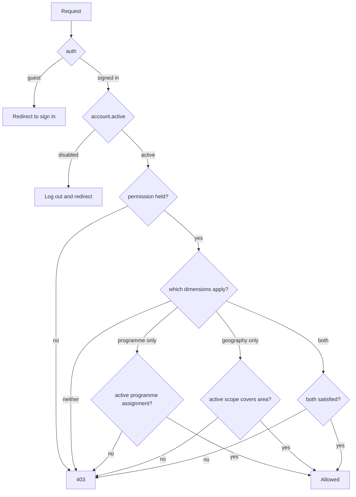

# ORWeMS Phase 3C — Programme & Geographic Access Scope Foundation
> **Architectural rule:** Phase 3B answers **WHAT** an account may do
> (`User::hasPermission()`). Phase 3C answers **WHERE** that authority applies.
> The two questions are answered separately, by separate tables, and a *scope*
> can only ever narrow a permission that has already been granted. Nothing in
> this phase grants a capability.

## 1. Why scope ≠ permission

A permission is a capability: `beneficiaries.view`. A scope is a reach: *"…in
Niger State, for the WICHOV-PILOT programme"*. Conflating them is the classic
way humanitarian systems leak — if the two were one concept, granting a case
officer their normal capability would also decide, implicitly and invisibly,
which children they could read.

The separation buys four things:

- **The vocabulary does not grow with geography.** There is one
  `beneficiaries.view`, not `beneficiaries.view.niger`. When WICHOV opens a
  sixth state, no permission code changes.
- **Scope is data, not code.** It is rows in a table: reviewable, revocable,
  auditable, and correctable by an operator with the right permission rather
  than by a deployment.
- **Roles stay portable.** The same `case_officer` role serves every state and
  every programme, which is exactly what `RoleSeeder` documents when it records
  the rejection of `niger_admin` / `fct_officer`.
- **Either half alone is inert.** A capability with no scope has nowhere to
  operate; a scope with no capability confers nothing. Both facts are asserted
  by tests, not merely asserted in prose.

The rule as implemented in `App\Support\Authorization\ScopeAuthorization`:

1. **SCOPE NARROWS, IT NEVER GRANTS.** Every method is called *after* a
   permission has been confirmed. `ProgrammeScopeTest` and
   `GeographicScopeTest` both assert `permissionCodes()` is empty even when the
   account holds a perfect scope.
2. **DENY BY DEFAULT, STRUCTURALLY.** No wildcard, no "unrestricted" fallback,
   no `null` meaning "all". `allowsScope(null, null)` is refused.

## 2. Programme scope model

Table `programme_user` — a normalised pivot, not a column on `users`.

| Column | Meaning |
| --- | --- |
| `user_id` | FK → `users`, `ON DELETE RESTRICT` |
| `programme_id` | FK → `programmes`, `ON DELETE RESTRICT` |
| `is_active` | `true` = currently assigned, `false` = withdrawn |
| `created_at` / `updated_at` | when the assignment was made |

Constraints: `UNIQUE (user_id, programme_id)`, plus indexes on `user_id` and
`programme_id`. One account is assigned to a programme at most once;
reactivation flips `is_active` rather than inserting a second row.

`Programme` is reference data that changes state. An assignment to a programme
that is `closed`, `suspended` or otherwise not `active` resolves to **false** —
`ScopeAuthorization::allowsProgramme()` requires the pivot row *and*
`programmes.status = active`. The assignment records who was responsible; it
does not assert the programme may still be worked on.

## 3. Geographic scope model

Table `user_geographic_scopes` — one row per area granted, at exactly one
level.

| Column | Meaning |
| --- | --- |
| `user_id` | FK → `users`, `ON DELETE RESTRICT` |
| `level` | one of `country`, `state`, `lga`, `ward`, `community` |
| `country_id` | FK → `countries` (nullable) |
| `state_id` | FK → `states` (nullable) |
| `local_government_area_id` | FK → `local_government_areas` (nullable) |
| `ward_id` | FK → `wards` (nullable) |
| `community_id` | FK → `communities` (nullable) |
| `is_active` | `true` = currently granted, `false` = withdrawn |

`App\Enums\GeographicScopeLevel` is the single map from a level string to its
column and its Eloquent model. The table deliberately uses **five real foreign
keys rather than one polymorphic `target_type`/`target_id` pair**: real FKs let
the database refuse a scope that points at a deleted or non-existent area, and
they keep the geography hierarchy referentially honest.

**Exactly one of the five columns is non-null, and it must be the one `level`
declares.** That invariant is enforced twice:

- **MySQL:** a raw `CHECK` constraint on the table, because SQLite cannot add a
  `CHECK` to an already-created table.
- **Both engines:** `UserGeographicScope::saving()` validates the same rule and
  raises a `ValidationException`, so SQLite refuses the identical rows. This is
  the split Phase 2.1 established for `person_relationships`.

The `saving` hook reads the *raw* attribute rather than the enum cast, so a
corrupt or unknown `level` is a validation failure instead of a `ValueError`.
`GeographicScopeLevel::tryForModel()` returns `null` for a model outside the
hierarchy, which callers turn into a denial instead of an exception.

The model does **not** allow `user_id` or `is_active` to be mass assigned:
ownership comes from the relationship, and activation is a security decision.

## 4. Hierarchy semantics

`country → state → lga → ward → community`.

A scope is granted **upward-only inheritance**: it covers the area it names and
everything beneath it, and reaches nothing above or beside it. A state scope
covers its LGAs, wards and communities; it does not cover a neighbouring state
and it does not cover the country.

The hierarchy is **derived at query time, never stored**.
`ScopeAuthorization::coveringKeys()` walks the live geography rows and builds the
set of `level:id` keys that would cover the target — for a community:
`community:x`, `ward:y`, `lga:z`, `state:s`, `country:c`. The account's active
scope rows are turned into the same keys and the two sets are intersected.

Consequences, each of which is a test rather than a claim:

- **Moving a ward moves the decision.** Re-parenting a ward to another LGA
  changes every dependent scope answer on the next query. Nothing is copied, so
  there is no stale descendant list to reconcile and no re-seeding step.
- **New descendants are covered immediately.** A ward created after the grant is
  inside a state scope without touching `user_geographic_scopes`.
- **One grant stays one row.** A country scope is a single row, not thousands of
  descendant rows to audit.
- **An incomplete hierarchy narrows access.** A settlement with no ward resolves
  through its LGA; it is never reachable "via ward", because no ward key is
  produced. A missing ancestor contributes no key, which can only reduce what
  matches.
- **Travel is one-directional.** `Community → … → Country` is walked; a state
  scope never produces a key for a sibling or for the country above it.

## 5. Combination semantics

The rule: **when both dimensions apply to a record, both must be held.**

| Record shape | Required scope |
| --- | --- |
| Programme only | active `programme_user` row for that programme |
| Geography only | active scope covering that area |
| Programme **and** geography | both, independently satisfied |
| Neither | refused — `allowsScope(null, null)` is a caller error, not a wildcard |

Neither dimension widens the other, which is what `ScopeCombinationTest`
pins down:

- a country-wide geographic scope does **not** imply membership of any programme;
- a programme assignment does **not** imply reach beyond the areas actually
  scoped;
- the right programme in the wrong place is refused, and so is the right place
  under the wrong programme.

A scope record with no matching capability is also refused: the test asserts an
account holding programme *and* geography still has an empty `permissionCodes()`.

## 6. Role interaction

Roles are untouched. No geographic or programme column exists on `roles`,
`permissions`, `role_user` or `permission_role`, and none may be added — that is
the rule Phase 3B states for Phase 3C, and Phase 3C honours it.

**No role, account id or email bypasses scope.** In particular,
`super_administrator` holds every *permission* through ordinary, visible
role-permission rows but is given **no implicit scope**. A national operator is
expressed as a country-level geographic scope plus explicit programme
assignments — visible in the database and revocable like any other grant. This
is a documented decision rather than an oversight: an implicit wildcard would be
exactly the hidden bypass the phase exists to avoid.

Consequently `system_administrator`, which resolves accounts and roles, cannot
reach a single child's record by being scoped to every state, because scope
never creates the capability in the first place.

Middleware order is unchanged and load-bearing: `auth` → `account.active` →
`permission`. Scope is consulted *after* permission, inside the application, not
by a middleware.

## 7. Active / inactive

Four independent gates must all be open; each can close alone:

1. **Account** — `users.status`. A disabled account is stopped at
   `account.active` before scope is consulted at all.
2. **Role** — `roles.is_active`. A withdrawn role confers no permissions.
3. **Assignment** — `programme_user.is_active` / `user_geographic_scopes.is_active`.
4. **Target** — `programmes.status`, and `is_active` on the geographic area
   itself. Deactivating a state refuses it even to an operator who still holds
   the assignment.

**Deactivation is never deletion.** Withdrawing an assignment sets
`is_active = false` and leaves the row, so an account can be reactivated with
its history intact. Re-scoping to the same area is idempotent: it reactivates
rather than erroring or duplicating. Every FK is `RESTRICT`, so an account,
programme or area that is still referenced cannot disappear out from under the
record of who was granted what.

## 8. Fail-closed behaviour

Every path that could resolve to "allow" has a documented path to "deny":

| Situation | Result |
| --- | --- |
| No scope rows at all | refused |
| `allowsScope(null, null)` | refused |
| Unknown / non-geography model | refused, never thrown |
| Scope row missing | non-match |
| Scope row deactivated | non-match |
| Target area deactivated | non-match |
| Programme not active | non-match |
| Hierarchy link missing | fewer covering keys → non-match |
| Account disabled | refused at `account.active`, before scope |
| Permission absent | refused before scope is consulted |

There is no catch-all branch, no `return true` escape hatch, and no ordering in
which a partial or corrupt record produces an allow. Malformed scope rows are
refused by the database *and* the model, so they cannot exist to be misread.

The denial paths are proven by tests that **bypass application validation**
(`ScopeDatabaseIntegrityTest` writes straight through `DB::table(...)`) so the
engine itself is what refuses: duplicate assignment, dangling `user_id`,
dangling area reference, two areas on one row, `level` disagreeing with its
area, unknown `level`, and deletion of a still-referenced account, programme or
area.

Four MySQL-only CHECK tests are skipped on SQLite, where the identical rule is
covered by the model-guard tests — the same engine split as Phase 2.1.

## 9. Database relationships

```
users ──< programme_user >── programmes
  │         (user_id, programme_id, is_active; UNIQUE; RESTRICT both ways)
  │
  └──< user_geographic_scopes
         (user_id, level, country_id?, state_id?, local_government_area_id?,
          ward_id?, community_id?, is_active)
              │   EXACTLY ONE of the five area columns non-null,
              │   and it must be the one `level` declares (CHECK + model guard)
              ├──> countries   (RESTRICT)
              ├──> states      (RESTRICT)
              ├──> local_government_areas (RESTRICT)
              ├──> wards       (RESTRICT)
              └──> communities (RESTRICT)
```

Indexes on `user_geographic_scopes`: one per level column, each unique *within*
that level and *scoped to the account* — so an account cannot hold Niger twice,
but two accounts may hold Niger, and one account may hold the country, a state
and an LGA simultaneously.

Eloquent surface:

- `User`: `programmes()`, `activeProgrammes()`, `geographicScopes()`,
  `activeGeographicScopes()`, `hasProgrammeAccess()`, `hasGeographicAccess()`,
  `hasScopeFor()`, `assignProgrammeScope()`, `revokeProgrammeScope()`,
  `assignGeographicScope()`, `revokeGeographicScope()` — all idempotent.
- `Programme`: `users()` (`BelongsToMany`).
- `UserGeographicScope`: `user()`, `country()`, `state()`,
  `localGovernmentArea()`, `ward()`, `community()`, `scopeId()`, `isActive()`.
- `ScopeAuthorization`: `allowsProgramme()`, `allowsGeography()`,
  `allowsGeographyId()`, `allowsScope()`.

Migration order matters: `2026_10_02_110000_create_programme_user_table` then
`2026_10_02_110100_create_user_geographic_scopes_table`, both after the
geography and Phase 3B RBAC migrations they reference.
## 10. How later phases consume this

Phase 3C ships **no route, no controller, no view and no middleware**.
`ScopePrivilegeEscalationTest` enumerates every registered route and fails if a
URI containing `scope`, `programme_user` or `geographic` appears, and probes
plausible scope-administration URLs expecting `404`.

Consumption later is deliberately a two-step call, never scope alone:

```php
if (! $user->hasPermission('beneficiaries.view')) {
    abort(403);                       // WHAT
}

if (! $user->hasScopeFor($beneficiary->programme, $beneficiary->community)) {
    abort(403);                       // WHERE
}
```

`hasScopeFor()` accepts either dimension alone, so a programme-only or
geography-only record works without special-casing. For per-record answers
rather than a single lookup, `allowsGeography()` / `allowsGeographyId()` check
one area at a time; a future phase may add a scope-aware `whereHas` helper so
filtering a list does not issue one query per row — deferred below.

## 11. Deferred

Explicitly **not** in Phase 3C, each with its reason:

1. **Scope administration UI / routes.** No screens exist to assign, review or
   withdraw scope. Until they do, assignments are made in code and by seeder,
   and the escalation surface is provably empty (§8's route enumeration).
   This is the next phase's job.
2. **Scope-aware query helpers.** `allowsGeography()` is per-record; bulk
   filtering needs a set-based helper or a join, deferred until a real consumer
   exists so the shape follows the query pattern actually used.
3. **Middleware-gated enforcement.** Enforcement is application-level today. A
   `scope` middleware added before a consumer exists would invent a
   configuration format for no caller.
4. **Composite scope keys.** A beneficiary belongs to a programme *and* a
   community; the AND rule covers that without storing a combined key. Keeping
   the two dimensions separate keeps them independently revocable.
5. **Caching the hierarchy walk.** `coveringKeys()` issues a handful of queries
   per check. Correctness first; optimise when profiling shows it matters, and
   any cache must be invalidated on geography re-parenting.
6. **Additional scope levels** (e.g. a facility). `GeographicScopeLevel` is a
   stable string-backed enum, so a new level is additive and needs no
   renumbering — but it should be driven by a real module, not speculation.

## Appendix — decision flow



Scope is the **last** gate, and it can only answer "no".


